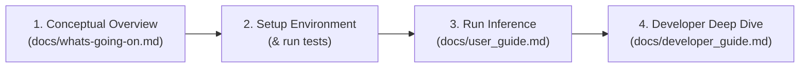

# Aetheria: Cosmic Dust Scattering ANN

**Aetheria** is an astrophysics and machine learning framework designed to simulate light scattering from cosmic dust. Using Artificial Neural Networks (ANNs), it predicts full-phase scattering intensity ($S_{11}$), cross-polarization ($S_{12}$), and degree of linear polarization ($P$) curves from dust grain composition, particle size, and scattering angle.

---

##  Onboarding Roadmap for New Contributors

Welcome to the team! If you are new to the project, here is the recommended reading and setup order to get up to speed in under 30 minutes:



1. **Step 1: Understand the Physics & Goals**
   - Read  **[Conceptual Overview (What's Going On?)](file:///home/maxmk/aetheria/docs/whats-going-on.md)**.
   - *Key takeaway:* We replace expensive numerical electrodynamics solvers (hours of compute) with neural surrogates that predict scattering curves in milliseconds.

2. **Step 2: Set Up Environment & Verify Installation**
   - Follow the [Quick Start](#quick-start) below.
   - Run `python3 -m unittest discover tests` to verify all processed data, scalers, and models work out of the box.

3. **Step 3: Try Out Inference**
   - Open  **[User Guide](file:///home/maxmk/aetheria/docs/user_guide.md)** and execute the ready-to-run Python snippet to generate phase curves for custom dust materials.

4. **Step 4: Explore Pipeline & Architecture**
   - Review  **[Developer & Pipeline Guide](file:///home/maxmk/aetheria/docs/developer_guide.md)** before modifying ingestion, loss functions, or network architectures.

---

##  Documentation Index

Detailed guides are located in the [`docs/`](file:///home/maxmk/aetheria/docs/) directory:

-  **[Conceptual Overview (What's Going On?)](file:///home/maxmk/aetheria/docs/whats-going-on.md)**:
  - Intuitive physical motivation behind light scattering, Stokes parameters, and Mueller matrix elements.
  - High-level tour of the 4 pipeline stages.
  - Summary of the 4 polarization modeling methodologies.

-  **[User Guide](file:///home/maxmk/aetheria/docs/user_guide.md)**:
  - Physical feature definitions, units, and valid domains.
  - Comprehensive reference table of all 25 dataset compositions (synthetic & laboratory).
  - Standalone Python inference script demonstrating $S_{11}$, $S_{12}$, and all 4 polarization approaches.
  - Benchmark metrics interpretation ($R^2$, MSE, MAE) and guide to diagnostic plots in `results/`.

-  **[Developer & Pipeline Guide](file:///home/maxmk/aetheria/docs/developer_guide.md)**:
  - End-to-end Mermaid dataflow diagram from raw files to evaluated curves.
  - Detailed breakdown of each script:
    - [`src/data_loader.py`](file:///home/maxmk/aetheria/src/data_loader.py): Multi-format ingestion (`.h5`, `.dat`, `.txt`), $30^\circ$ normalization, and noise thresholds ($S_{11} > 10^{-4}$).
    - [`src/preprocessing.py`](file:///home/maxmk/aetheria/src/preprocessing.py): Size parameter $x = \frac{2\pi r}{\lambda}$, periodic angle features, log-clipped absorption, target IQR filtering, and holdout partitioning.
    - [`src/train.py`](file:///home/maxmk/aetheria/src/train.py): ReLU and Tanh MLP regressors alongside PyTorch / Skorch bounded parameter network with custom masked and peak-penalized loss.
    - [`src/evaluate.py`](file:///home/maxmk/aetheria/src/evaluate.py): Inverse transformations, aggregate vs. per-composition $R^2$, and automated generation of $0^\circ \text{--} 180^\circ$ phase curves.
  - Instructions for changing the holdout composition, adding new optical data, and running tests.

---

##  Quick Start

### 1. Prerequisites & Environment Setup

Python **3.10+** is required. We recommend using a virtual environment:

```bash
# Create and activate virtual environment
python3 -m venv .venv
source .venv/bin/activate

# Install all dependencies (PyTorch, Skorch, scikit-learn, etc.)
pip install -r requirements.txt
```

### 2. Verify Your Setup with Unit Tests

Confirm that the preprocessed datasets, scalers, and trained models are operational:

```bash
python3 -m unittest discover tests
```
*(All 4 tests should pass in under a second).*

### 3. Run the Full Data Pipeline (Optional)

The repository already includes preprocessed data in `data/processed/` and pre-trained model artifacts in `models/`. To execute a full end-to-end retraining run:

```bash
# 1. Ingest raw simulation & lab files -> data/processed/
python3 src/data_loader.py

# 2. Engineer features, filter outliers, split train/test/holdout -> data/features/
python3 src/preprocessing.py

# 3. Train all 4 scattering neural networks -> models/
python3 src/train.py

# 4. Evaluate models and render comparison plots -> results/
python3 src/evaluate.py
```

---

##  Four Polarization Modeling Approaches

Because linear polarization ($P = -S_{12}/S_{11}$) is sensitive to complex wave interference and material absorption, Aetheria implements four complementary modeling strategies:

1. **Analytical Equation Model (Recommended)**: A PyTorch neural network predicts the 4 shape parameters $(b, c_1, c_2, a_0)$ of the empirical phase function $P(\alpha) = b \cdot |\sin\alpha|^{c_1} \cdot |\cos(\alpha/2)|^{c_2} \cdot \sin((\alpha - a_0)/2)$. Guarantees smooth, non-oscillating curves and explicit inversion angle ($a_0$).
2. **Hybrid Fit Model**: Combines pointwise direct MLP predictions with `scipy.optimize.curve_fit` to balance neural flexibility with smooth physical regularization.
3. **Derived Ratio**: Unscales predicted intensity ($S_{11}$) and cross-polarization ($S_{12}$) to compute $P_{\text{derived}} = -S_{12}/S_{11}$, enforcing internal Mueller matrix harmony.
4. **Direct MLP Regressor**: Multi-layer perceptron directly trained on quantile-transformed polarization for capturing localized resonance peaks.

---

##  Repository Structure

```
├── data/
│   ├── raw/                 # Heterogeneous FASTMM (.h5), MSTM (.dat), and lab (.txt) data
|       ├── FASTMM_data/     # FASTMM synthetic data stored in .h5 files    
|       ├── MSTM_data/       # MSTM synthetic data stored in .dat files        
|       ├── lab_data         # Lab data from Grenada-Amsterdam database stored in .txt files
                             # The 2nd, 3rd, and 4th lines of the .txt file need to be
                             # refractive index, particle radius, and particle count, respectively
                             # These get added to the base .txt file from Grenada-Amsterdam
│   ├── processed/           # Standardized Parquet files, scalers, and diagnostic graphs
│   └── features/            # Preprocessed train, test, and holdout split datasets
├── docs/
│   ├── user_guide.md        # User Guide (features, inference, model comparison, plots)
│   ├── developer_guide.md   # Developer Guide (data engineering, loss functions, architecture)
│   └── whats-going-on.md    # Conceptual high-level summary of the physics and codebase
├── models/                  # Trained neural network artifacts (.joblib)
├── results/                 # Diagnostic and comparison phase curves per composition
│   ├── S11/                 # Intensity phase curves
│   ├── S12/                 # Cross-polarization element curves
│   ├── polarization/        # Direct MLP polarization curves
│   ├── derived_polarization/# Derived ratio (-S12/S11) curves
│   ├── polarization_equation/# Analytical equation curves
│   └── hybrid_polarization/ # Hybrid fit curves
├── src/
│   ├── data_loader.py       # Ingestion, normalization at 30 deg, and noise filtering
│   ├── preprocessing.py     # Feature engineering, IQR outlier filtering, scaling, holdout split
│   ├── train.py             # Model training (MLPRegressors and PyTorch Skorch parameter network)
│   └── evaluate.py          # Metrics, inverse transformations, and plotting suite
├── tests/
│   └── test_pipeline.py     # Automated onboarding and sanity test suite
└── requirements.txt         # Project dependencies
```
