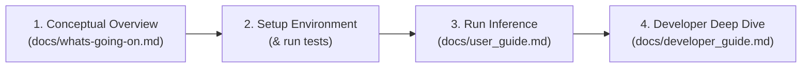

# Aetheria: Cosmic Dust Scattering ANN

**Aetheria** is an astrophysics and machine learning framework designed to simulate light scattering from cosmic dust. Using Artificial Neural Networks (ANNs), it predicts full-phase scattering intensity ($S_{11}$), cross-polarization ($S_{12}$), and degree of linear polarization ($P$) curves from dust grain composition, particle size, and scattering angle.

---

##  Onboarding Roadmap for New Contributors

Welcome to the team! If you are new to the project, here is the recommended reading and setup order to get up to speed in under 30 minutes:



1. **Step 1: Understand the Physics & Goals**
   - Read  **[Conceptual Overview (What's Going On?)](file:///home/maxmk/aetheria/docs/whats-going-on.md)**.
   - *Key takeaway:* We replace expensive numerical electrodynamics solvers (hours of compute) with neural surrogates that predict scattering curves in milliseconds.

2. **Step 2: Set Up Environment & Minimal Data**
   - Follow the [Quick Start](#quick-start) below.
   - Set up the minimal `data/raw/` directory structure (`FASTMM_data/`, `MSTM_data/`, `lab_data/`).
   - Run the data pipeline and tests (`python3 -m unittest discover tests`).

3. **Step 3: Try Out Inference**
   - Open  **[User Guide](file:///home/maxmk/aetheria/docs/user_guide.md)** and execute the ready-to-run Python snippet to generate phase curves for custom dust materials.

4. **Step 4: Explore Pipeline & Architecture**
   - Review  **[Developer & Pipeline Guide](file:///home/maxmk/aetheria/docs/developer_guide.md)** before modifying ingestion, loss functions, or network architectures.

---

##  Documentation Index

Detailed guides are located in the [`docs/`](file:///home/maxmk/aetheria/docs/) directory:

-  **[Conceptual Overview (What's Going On?)](file:///home/maxmk/aetheria/docs/whats-going-on.md)**:
  - Intuitive physical motivation behind light scattering, Stokes parameters, and Mueller matrix elements.
  - High-level tour of the 4 pipeline stages.
  - Summary of the 4 polarization modeling methodologies.

-  **[User Guide](file:///home/maxmk/aetheria/docs/user_guide.md)**:
  - Physical feature definitions, units, and valid domains.
  - Comprehensive reference table of all 25 dataset compositions (synthetic & laboratory).
  - Standalone Python inference script demonstrating $S_{11}$, $S_{12}$, and all 4 polarization approaches.
  - Benchmark metrics interpretation ($R^2$, MSE, MAE) and guide to diagnostic plots in `results/`.

-  **[Developer & Pipeline Guide](file:///home/maxmk/aetheria/docs/developer_guide.md)**:
  - End-to-end Mermaid dataflow diagram from raw files to evaluated curves.
  - Detailed breakdown of each script:
    - [`src/data_loader.py`](file:///home/maxmk/aetheria/src/data_loader.py): Multi-format ingestion (`.h5`, `.dat`, `.txt`), $30^\circ$ normalization, and noise thresholds ($S_{11} > 10^{-4}$).
    - [`src/preprocessing.py`](file:///home/maxmk/aetheria/src/preprocessing.py): Size parameter $x = \frac{2\pi r}{\lambda}$, periodic angle features, log-clipped absorption, target IQR filtering, and holdout partitioning.
    - [`src/train.py`](file:///home/maxmk/aetheria/src/train.py): ReLU and Tanh MLP regressors alongside PyTorch / Skorch bounded parameter network with custom masked and peak-penalized loss.
    - [`src/evaluate.py`](file:///home/maxmk/aetheria/src/evaluate.py): Inverse transformations, aggregate vs. per-composition $R^2$, and automated generation of $0^\circ \text{--} 180^\circ$ phase curves.
  - Instructions for changing the holdout composition, adding new optical data, and running tests.

---

##  Quick Start

### 1. Prerequisites & Environment Setup

Python **3.10+** is required. We recommend using a virtual environment:

```bash
# Create and activate virtual environment
python3 -m venv .venv
source .venv/bin/activate

# Install all dependencies (PyTorch, Skorch, scikit-learn, etc.)
pip install -r requirements.txt
```

### 2. Minimal Data Directory Setup (`/data` is gitignored)

> [!IMPORTANT]
> The `data/` directory (along with `models/` and `results/`) is excluded from Git version control via [`.gitignore`](file:///home/maxmk/aetheria/.gitignore) due to large file sizes. A freshly cloned repository will **not** contain raw, processed, or trained model files.

To run the pipeline from scratch, you must provide raw data organized in the following minimal structure under `data/raw/`:

```bash
# Create minimal raw data directories
mkdir -p data/raw/FASTMM_data data/raw/MSTM_data data/raw/lab_data
```

```
data/
└── raw/
    ├── FASTMM_data/         # Discrete Dipole Approximation simulation files (.h5)
    ├── MSTM_data/           # Multiple Sphere T-Matrix simulation files (.dat)
    └── lab_data/            # Amsterdam-Granada experimental laboratory files (.txt)
```

#### Raw Data Requirements:
1. **FASTMM (`data/raw/FASTMM_data/`)**:
   - **Format**: HDF5 (`.h5`).
   - **Filename convention**: Encodes composition, monomer size in $\mu\text{m}$, and monomer count $N$:
     - E.g., `am_carbon_16k_01size_64cpu_64ave_output.h5` ($r = 0.1\ \mu\text{m}$, $N = 16,000$, material `am_carbon`).
     - E.g., `olivine_1638_005size_64ave.h5` ($r = 0.05\ \mu\text{m}$, $N = 1,638$, material `olivine`).
   - **Material mapping**: Material name in the filename must match or map to a key in [`MAT_TO_REF_IND`](file:///home/maxmk/aetheria/src/data_loader.py#L17) in [`src/data_loader.py`](file:///home/maxmk/aetheria/src/data_loader.py).
   - **Internal layout**: The 2nd HDF5 key contains the scattering matrix with columns `[theta (rad), S11, S12, ...]`.
   *(Note: Subdirectory name `fastmm` is also accepted by the loader).*

2. **MSTM (`data/raw/MSTM_data/`)**:
   - **Format**: Space-delimited ASCII (`.dat`). Can be headered or headless.
   - **Filename convention**: `<composition>_<size_code>_<particle_count>.dat` (e.g., `amorphous_carbon_64_1638.dat`, `iron_rich_pyroxene_64_16384.dat`). The last numeric token represents particle count $N$. Monomer radius defaults to $0.1\ \mu\text{m}$.
   - **Columns**: At least 3 columns:
     - Col 1: Scattering angle $\theta$ (degrees, $0^\circ \text{--} 180^\circ$, typically 181 points).
     - Col 2: $S_{11}$ (intensity).
     - Col 3: $-\frac{S_{12}}{S_{11}}$ (linear polarization ratio).
   *(Note: Subdirectory name `mstm` is also accepted by the loader).*

3. **Lab Data (`data/raw/lab_data/`)**:
   - **Format**: ASCII text (`.txt`) adapted from the Amsterdam-Granada Light Scattering Database.
   - **Mandatory 4-Line Metadata Header**: Experimental files must begin with physical metadata on lines 1–4:
     ```text
     BASALT - 647 nm
     refractive index: 1.52 + i0.001
     radius: 2.913
     particle count: 16000
     ```
     - Line 1: `[Material Name] - [Wavelength]`
     - Line 2: `refractive index: <real_n> + i<imag_k>`
     - Line 3: `radius: <radius_in_microns>`
     - Line 4: `particle count: <monomer_count>`
   - **Columns**: Followed by a table starting with header `theta(deg)` and columns including `theta(deg)`, `F11/F11(30deg)`, and `-F12/F11`.
   *(Note: Subdirectory name `lab` is also accepted by the loader).*

> [!NOTE]
> Downstream directories (`data/processed/`, `data/features/`, `models/`, and `results/`) are **created automatically** by the pipeline scripts. You only need to create and populate `data/raw/`.

### 3. Run the End-to-End Pipeline

Execute the 4 pipeline stages sequentially to ingest data, engineer features, train models, and generate evaluation plots:

```bash
# 1. Ingest raw simulation & lab files -> outputs data/processed/
python3 src/data_loader.py

# 2. Engineer features, filter outliers, split train/test/holdout -> outputs data/features/
python3 src/preprocessing.py

# 3. Train all 4 scattering neural networks -> outputs models/
python3 src/train.py

# 4. Evaluate models and render comparison plots -> outputs results/
python3 src/evaluate.py
```

### 4. Verify Your Setup with Unit Tests

Once the pipeline artifacts have been generated, run the automated test suite:

```bash
python3 -m unittest discover tests
```
*(All 4 tests verify preprocessed data, persisted scalers, trained models, and multi-model forward inference).*

---

##  Four Polarization Modeling Approaches

Because linear polarization ($P = -S_{12}/S_{11}$) is sensitive to complex wave interference and material absorption, Aetheria implements four complementary modeling strategies:

1. **Analytical Equation Model (Recommended)**: A PyTorch neural network predicts the 4 shape parameters $(b, c_1, c_2, a_0)$ of the empirical phase function $P(\alpha) = b \cdot |\sin\alpha|^{c_1} \cdot |\cos(\alpha/2)|^{c_2} \cdot \sin((\alpha - a_0)/2)$. Guarantees smooth, non-oscillating curves and explicit inversion angle ($a_0$).
2. **Hybrid Fit Model**: Combines pointwise direct MLP predictions with `scipy.optimize.curve_fit` to balance neural flexibility with smooth physical regularization.
3. **Derived Ratio**: Unscales predicted intensity ($S_{11}$) and cross-polarization ($S_{12}$) to compute $P_{\text{derived}} = -S_{12}/S_{11}$, enforcing internal Mueller matrix harmony.
4. **Direct MLP Regressor**: Multi-layer perceptron directly trained on quantile-transformed polarization for capturing localized resonance peaks.

---

##  Repository Structure

```
├── data/                    # Excluded from Git (.gitignore)
│   ├── raw/                 # Minimal input structure required for ingestion
│   │   ├── FASTMM_data/     # FASTMM synthetic data (.h5)
│   │   ├── MSTM_data/       # MSTM synthetic data (.dat)
│   │   └── lab_data/        # Amsterdam-Granada lab data with 4-line header (.txt)
│   ├── processed/           # Auto-generated: unified Parquet files, scalers, and diagnostic graphs
│   └── features/            # Auto-generated: preprocessed train, test, and holdout split datasets
├── docs/
│   ├── user_guide.md        # User Guide (features, inference, model comparison, plots)
│   ├── developer_guide.md   # Developer Guide (data engineering, loss functions, architecture)
│   └── whats-going-on.md    # Conceptual high-level summary of the physics and codebase
├── models/                  # Excluded from Git: auto-generated trained model artifacts (.joblib)
├── results/                 # Excluded from Git: auto-generated comparison phase curves per composition
│   ├── S11/                 # Intensity phase curves
│   ├── S12/                 # Cross-polarization element curves
│   ├── polarization/        # Direct MLP polarization curves
│   ├── derived_polarization/# Derived ratio (-S12/S11) curves
│   ├── polarization_equation/# Analytical equation curves
│   └── hybrid_polarization/ # Hybrid fit curves
├── src/
│   ├── data_loader.py       # Ingestion, normalization at 30 deg, and noise filtering
│   ├── preprocessing.py     # Feature engineering, IQR outlier filtering, scaling, holdout split
│   ├── train.py             # Model training (MLPRegressors and PyTorch Skorch parameter network)
│   └── evaluate.py          # Metrics, inverse transformations, and plotting suite
├── tests/
│   └── test_pipeline.py     # Automated onboarding and sanity test suite
└── requirements.txt         # Project dependencies
```
