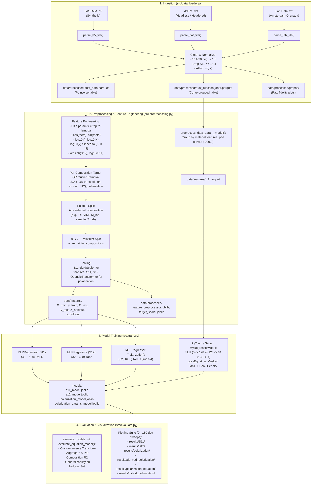

# Cosmic Dust Scattering ANN — Developer & Data Pipeline Guide

This guide provides a comprehensive technical breakdown of the entire data engineering, modeling, and evaluation pipeline in this repository. It details each script step, the physical and mathematical rationale behind every transformation, the neural architectures, and instructions for extending the pipeline.

---

## 1. System Architecture & End-to-End Dataflow

The pipeline transforms heterogeneous raw simulation and laboratory datasets into normalized, physics-informed representations, trains specialized regression networks, and evaluates cross-composition generalizability.



---

## 2. Step 1: Data Ingestion (`src/data_loader.py`)

The ingestion script [`src/data_loader.py`](../src/data_loader.py) aggregates heterogeneous data from distinct optical simulations and experimental laboratories into a single standardized schema.

### Minimal `/data` Directory Requirements (Git Exclusions)

> [!IMPORTANT]
> Because raw scattering simulation files and laboratory scans are large, the entire `data/` directory (along with `models/` and `results/`) is excluded from Git tracking via [`.gitignore`](../.gitignore).
> When you clone the repository from GitHub, `data/` does **not** exist.

To execute the data loader, you must provide the minimal input directory structure under `data/raw/`:

```bash
mkdir -p data/raw/FASTMM_data data/raw/MSTM_data data/raw/lab_data
```

```
data/
└── raw/
    ├── FASTMM_data/         # FASTMM simulation files (.h5) [aliases: fastmm, fastmm_data]
    ├── MSTM_data/           # MSTM simulation files (.dat)   [aliases: mstm, mstm_data]
    └── lab_data/            # Amsterdam-Granada lab files (.txt) [aliases: lab, Lab_data]
```

#### What is Generated Automatically?
You **do not** need to create the following directories; they are dynamically created by the pipeline scripts:
- `data/processed/` & `data/processed/graphs/`: Created by [`src/data_loader.py`](../src/data_loader.py) to store `dust_data.parquet`, `dust_function_data.parquet`, and diagnostic plots.
- `data/features/`: Created by [`src/preprocessing.py`](../src/preprocessing.py) to store train/test/holdout Parquet datasets.
- `models/`: Created by [`src/train.py`](../src/train.py) to store serialized neural networks (`.joblib`).
- `results/`: Created by [`src/evaluate.py`](../src/evaluate.py) to store evaluation phase plots.

### File Parsing Implementations
1. **FASTMM Simulation HDF5 Files ([`parse_h5_file`](../src/data_loader.py#L43))**:
   - *Structure*: Hierarchical HDF5 containing scattering matrices where rows/columns correspond to variables across angle steps of $0.5^\circ$.
   - *Filename Metadata*: Metadata is parsed from string naming conventions:
     - Example: `am_carbon_01size_8k_output.h5` $\rightarrow$ radius $r = 0.1\ \mu\text{m}$, particle count $N = 8000$, composition `am_carbon`.
   - *Composition Normalization*: Synonyms are standardized (e.g., `amorphous_carbon` and `amorphous__carbon` $\rightarrow$ `am_carbon`).
2. **MSTM Simulation DAT Files ([`parse_dat_file`](../src/data_loader.py#L165))**:
   - *Structure*: Handles both **headered** files (with scale factor blocks) and **headless** files (direct numerical tables).
   - *Complex Refractive Index Extraction*: When headers exist, refractive indices $(n, k)$ are extracted via regex:
     $$\text{ref index scale factors} \quad \rightarrow \quad n, k$$
     Otherwise, it falls back to the [`MAT_TO_REF_IND`](../src/data_loader.py#L17) physical dictionary.
   - *Column Mapping*: In MSTM, column 1 is scattering angle $\theta$ (converted from degrees to radians), column 2 is $S_{11}$, and column 3 is the linear polarization ratio $-\frac{S_{12}}{S_{11}}$. The physical element is reconstructed via:
     $$S_{12} = \left(\frac{S_{12}}{S_{11}}\right)_{\text{col3}} \cdot S_{11}$$
3. **Amsterdam-Granada Experimental Lab Files ([`parse_lab_file`](../src/data_loader.py#L365))**:
   - *Structure*: Text files containing experimental measurements of real mineral samples.
   - *Metadata Extraction*: Header blocks contain refractive indices, mean radius, and particle counts.
   - *Suffix Convention*: Compositions are suffixed with `_lab` (e.g., `olivine_m_lab`, `palagonite_lab`) to distinguish laboratory measurements from idealized synthetic computer models.

### Techniques & Physical Rationale

#### A. Intensity Normalization at $\theta = 30^\circ$
- **Problem**: Different computer simulation codes (FASTMM, MSTM) and physical laboratory instruments use arbitrary or disparate absolute flux units. FASTMM outputs unscaled cross-sections, while laboratory goniospectrophotometers record relative photo-detector voltages.
- **Solution**: Normalize intensity by dividing both $S_{11}$ and $S_{12}$ by $S_{11}(30^\circ)$:
  $$S_{11}'(\theta) = \frac{S_{11}(\theta)}{S_{11}(30^\circ)}, \quad S_{12}'(\theta) = \frac{S_{12}(\theta)}{S_{11}(30^\circ)}$$
- **Rationale**: Choosing $30^\circ$ preserves the relative polarization ratio:
  $$P(\theta) = -\frac{S_{12}'(\theta)}{S_{11}'(\theta)} = -\frac{S_{12}(\theta) / S_{11}(30^\circ)}{S_{11}(\theta) / S_{11}(30^\circ)} = -\frac{S_{12}(\theta)}{S_{11}(\theta)}$$
  while placing all intensity curves across all instruments onto an identical physical reference point ($S_{11}'(30^\circ) = 1.0$).

#### B. Filtering Low-Intensity Noise
- **Threshold**: Rows where $S_{11} \le 10^{-4}$ are filtered out:
  ```python
  df = df[df['S11'] > 1e-4].copy()
  ```
- **Rationale**: Linear polarization is calculated as $P = -S_{12}/S_{11}$. When intensity approaches zero (deep minima or high absorption), floating-point errors and detector background noise in $S_{12}$ cause massive unphysical polarization spikes ($|P| \gg 1.0$), poisoning training gradients.

#### C. Dual Output Structure
[`load_data`](../src/data_loader.py#L442) produces two distinct artifacts in [`data/processed/`](../data/processed/):
- `dust_data.parquet`: Flattened, pointwise dataset where each row corresponds to an individual angular measurement $(\theta, S_{11}, S_{12}, P)$ with associated material features. Used by standard MLP regressors.
- `dust_function_data.parquet`: Collapsed dataset where full angular vectors $(\vec{\theta}, \vec{S}_{11}, \vec{P})$ are stored as arrays per dust particle geometry. Used by the analytical equation model.

#### D. Pre-Processing Diagnostic Verification
[`generate_data_plots`](../src/data_loader.py#L304) immediately renders raw scatter curves for $S_{11}$, $S_{12}$, and $P$ per composition into `data/processed/graphs/`, enabling immediate visual inspection of raw data fidelity before downstream learning.

---

## 3. Step 2: Feature Engineering & Preprocessing (`src/preprocessing.py`)

The preprocessing module [`src/preprocessing.py`](../src/preprocessing.py) converts raw physical measurements into features optimized for gradient-based neural network optimization.

### Feature Engineering Details

#### 1. Dimensionless Size Parameter ($x$)
- **Formula**:
  $$x = \frac{2\pi r}{\lambda}$$
  *(Implemented using $\lambda = 0.65\ \mu\text{m}$)*
- **Rationale**: In electromagnetic scattering theory (Mie theory), absolute particle radius $r$ does not govern scattering mechanics in isolation. The dimensionless ratio $x = 2\pi r / \lambda$ defines whether the particle falls in the **Rayleigh regime** ($x \ll 1$), the **resonance/Mie regime** ($x \approx 1\text{--}10$), or the **geometric optics regime** ($x \gg 10$). Providing $x$ enables the network to learn regime boundaries directly.

#### 2. Trigonometric Decomposition of Angle ($\cos\theta, \sin\theta$)
- **Rationale**: Neural networks treat scalar inputs linearly. An angle of $0$ radians and $2\pi$ radians would appear as distant extremes rather than physically identical orientations. Projecting $\theta \mapsto (\cos\theta, \sin\theta)$ embeds the angular coordinates onto a continuous unit circle $\mathbb{S}^1$, linearizing harmonic oscillations in the scattering phase function.

#### 3. Logarithmic Scaling of Aggregate Structure
- **Formulas**:
  $$\text{log\_particle\_radius} = \log_{10}(r + 10^{-9})$$
  $$\text{log\_particle\_count} = \log_{10}(N + 10^{-9})$$
- **Rationale**: Aggregates range from single monomers ($N=1$) to massive clusters ($N=64,000$), and radii vary by orders of magnitude. Without log transforms, high-$N$ clusters would exert disproportionate leverage on neural weights.

#### 4. Log-Scaling and Clipping for Imaginary Refractive Index ($k$)
- **Formula**:
  $$\text{log\_refractive\_index\_img} = \operatorname{clip}\left(\log_{10}(k + 10^{-9}), -9.0, \infty\right)$$
- **Rationale**: Absorption indices in cosmic dust span more than **8 orders of magnitude**:
  - Pure water ice: $k \approx 1.43 \times 10^{-7}$
  - Amorphous silicates: $k \approx 0.0044$
  - Amorphous carbon: $k \approx 0.805$
  - Iron sulfide (pyrrhotite): $k \approx 1.86$
  Applying a $\log_{10}$ transform linearizes this vast physical span. The lower bound is clipped to $-9.0$ so that near-transparent materials ($k \approx 1.43 \times 10^{-7} \implies \approx -6.84$) remain clearly distinguishable from the clip boundary, while preventing numerical underflow when $k \to 0$.

#### 5. Target Transforms: $\log_{10}(S_{11})$ and $\operatorname{arcsinh}(S_{12})$
- **Intensity Target**: $\log_{10}(S_{11} + 10^{-9})$. Light intensity drops by $3\text{--}6$ orders of magnitude between forward scattering ($\theta \to 0^\circ$) and backscattering ($\theta \to 180^\circ$). Log-scaling stabilizes gradient descent across all angles.
- **Cross-Polarization Target**: $\operatorname{arcsinh}(S_{12})$. The matrix element $S_{12}$ oscillates across zero into both positive and negative values. While $\log_{10}$ fails for negative numbers, the inverse hyperbolic sine behaves logarithmically for large values while remaining strictly linear and smooth around zero:
  $$\operatorname{arcsinh}(z) \approx \begin{cases} z & |z| \ll 1 \\ \operatorname{sgn}(z) \ln(2|z|) & |z| \gg 1 \end{cases}$$
  This avoids gradient explosions near zero-crossings.

### Target-Only IQR Outlier Removal
- **Method**: Interquartile Range (IQR) filtering applied **strictly per-composition** on target variables (`arcsinh_S12`, `polarization`):
  $$[\text{lower}, \text{upper}] = [Q_1 - 3.0 \times \text{IQR}, \ Q_3 + 3.0 \times \text{IQR}]$$
- **Rationale**:
  - Anomalies in laboratory measurements (e.g., optical stray reflections) or numerical divergence in simulation codes can generate extreme outliers.
  - Applying the filter **per composition** ensures that materials with naturally high polarization (e.g., soot/carbon) are not erroneously discarded when compared against low-polarization minerals (e.g., silicates).
  - A conservative multiplier of $3.0$ (rather than the standard $1.5$) ensures only catastrophic outliers are eliminated.

### Generalizability Framework: Flexible Holdout Composition
- **Implementation**: The user can set `holdout_composition` to **any composition** present in the dataset (e.g., `OLIVINE M_lab`, `sample_7_lab`, `halley_dust`, `am_silicate`, etc.):
  ```python
  if holdout_composition:
      df_holdout = df[df['composition'] == holdout_composition].copy()
      df_rest = df[df['composition'] != holdout_composition].copy()
  ```
- **Rationale**: Standard random cross-validation randomly mixes angle points of every material into train and test splits. While this achieves high $R^2$ scores, it only tests interpolation. Withholding an entire composition isolates an unseen material, rigorously testing whether the ANN has learned general physical scattering principles or merely memorized material labels.

### Scaling Pipeline
1. **Features**: Scaled with `StandardScaler` (zero mean, unit variance).
2. **Targets**:
   - `log_S11` and `arcsinh_S12`: Scaled with `StandardScaler`.
   - `polarization`: Scaled with `QuantileTransformer(output_distribution='normal', n_quantiles=1000)`. Because polarization distributions are non-Gaussian and bounded within $[-1, 1]$ with high density near zero, quantile mapping linearizes the target space for the MLP.
3. **Artifact Persistence**: Preprocessor scalers are persisted to [`data/processed/feature_preprocessor.joblib`](../data/processed/feature_preprocessor.joblib) and [`data/processed/target_scaler.joblib`](../data/processed/target_scaler.joblib).

### Curve-Grouped Preprocessing (`preprocess_data_param_model`)
Collapses data by grouping identical material and particle parameters:
$$(\text{refractive\_index\_real}, \text{log\_refractive\_index\_img}, \log_{10} N, \log_{10} r, x)$$
and aggregating $\vec{\theta}, \log_{10}\vec{S}_{11}, \vec{P}$ into lists. Arrays are zero-padded to a global maximum sequence length with dummy values ($-999.0$), producing `X_train_f.parquet`, `y_train_f.parquet`, etc., for sequence-based neural learning.

---

## 4. Step 3: Model Architecture & Training (`src/train.py`)

The training pipeline in [`src/train.py`](../src/train.py) implements four specialized models tailored to the distinct mathematical dynamics of intensity and polarization.

### 1. Intensity Model ($S_{11}$)
- **Architecture**: Scikit-Learn `MLPRegressor`
- **Layers**: `(32, 16, 8)`
- **Activation**: `relu`
- **Optimizer**: Adam ($\max_{\text{iter}} = 1000$)
- **Target**: Standard-scaled $\log_{10}(S_{11})$
- **Rationale**: Intensity curves are monotonic and smooth across most phase angles; ReLU captures the forward-scattering diffraction drop-off with minimal regularization overhead.

### 2. Dedicated Cross-Polarization Model ($S_{12}$)
- **Architecture**: Scikit-Learn `MLPRegressor`
- **Layers**: `(32, 16, 8)`
- **Activation**: `tanh` (Hyperbolic Tangent)
- **Optimizer**: Adam ($\max_{\text{iter}} = 1500$)
- **Target**: Standard-scaled $\operatorname{arcsinh}(S_{12})$
- **Rationale**: Unlike $S_{11}$, $S_{12}$ oscillates across zero. Piecewise-linear ReLU activations create jagged, sharp kinks at zero-crossings. Using `tanh` guarantees infinite differentiability ($C^\infty$) and smooth transitions across zero.

### 3. Dedicated Direct Polarization Model
- **Architecture**: Scikit-Learn `MLPRegressor`
- **Layers**: `(32, 16, 8)`
- **Activation**: `relu`
- **Optimizer**: Adam ($\text{learning\_rate} = 0.0001, \max_{\text{iter}} = 2000$)
- **Target**: Quantile-transformed polarization
- **Rationale**: A reduced learning rate ($10^{-4}$) prevents gradient destabilization across complex resonance peaks.

### 4. Analytical Polarization Equation Model (`MyRegressorModel`)
Rather than predicting point-by-point values, this network predicts physical curve parameters for the analytical polarization phase function:
$$P(\alpha) = b \cdot |\sin\alpha|^{c_1} \cdot \left|\cos\frac{\alpha}{2}\right|^{c_2} \cdot \sin\left(\frac{\alpha - a_0}{2}\right)$$
where $\alpha = \pi - \theta$ is the phase angle.

#### Neural Architecture
Implemented in PyTorch and wrapped via Skorch:
- **Input Dimension**: 5 material properties ($n, \log_{10} k, \log_{10} N, \log_{10} r, x$).
- **Hidden Layers**: Fully connected `5 -> 128 -> 128 -> 64 -> 32 -> 4`
- **Activation**: `nn.SiLU()` (Swish: $x \cdot \sigma(x)$), which provides smooth gradient flow superior to ReLU for physical regression.
- **Output Layer & Bounding**:
  The raw outputs are mapped via Sigmoids to enforce strict physical bounds:
  $$\begin{aligned}
  b &= 0.01 + 6.0 \cdot \sigma(\text{raw}_0) && \in [0.01, 6.01] \quad \text{(Polarization Amplitude)} \\
  c_1 &= 0.1 + 10.0 \cdot \sigma(\text{raw}_1) && \in [0.1, 10.1] \quad \text{(Forward Phase Exponent)} \\
  c_2 &= 0.1 + 10.0 \cdot \sigma(\text{raw}_2) && \in [0.1, 10.1] \quad \text{(Backscatter Exponent)} \\
  a_0 &= 0.0 + 1.5 \cdot \sigma(\text{raw}_3) && \in [0.0, 1.5]\ \text{rad} \ (\approx 0^\circ \text{ to } 86^\circ) \quad \text{(Inversion Angle)}
  \end{aligned}$$

#### Custom Loss Function (`LossEquation`)
The loss is computed directly on the reconstructed curve against physical observations:
1. **Sequence Masking**: Ignores dummy padding ($-999.0$):
   $$\text{mask} = (\theta \neq -999.0)$$
2. **Gradient Boundary Safety**: Adds $+10^{-7}$ inside trigonometric terms to prevent $\ln(0)$ crashes when computing backward gradients at $\alpha = 0$ or $\pi$:
   $$\text{term}_1 = (|\sin\alpha| + 10^{-7})^{c_1}, \quad \text{term}_2 = \left(\left|\cos\frac{\alpha}{2}\right| + 10^{-7}\right)^{c_2}$$
3. **Compound Loss with Peak Amplitude Penalty**:
   $$\mathcal{L}_{\text{total}} = \text{MSE}_{\text{masked}}(P_{\text{pred}}, P_{\text{true}}) + \alpha \cdot \text{MSE}\left(\max P_{\text{pred}}, \ \max P_{\text{true}}\right)$$
   *(with $\alpha = 1.0$)*
   - **Rationale**: Standard MSE often penalizes the broad wings of the curve, causing the network to under-predict the maximum polarization peak $P_{\max}$. The explicit peak penalty forces the network to match the true peak amplitude.

---

## 5. Step 4: Evaluation & Visualization Suite (`src/evaluate.py`)

The evaluation script [`src/evaluate.py`](../src/evaluate.py) computes quantitative benchmarks and renders comparative diagnostic plots.

### Custom Inverse Transformation (`custom_inverse_transform`)
Because inputs and targets use mixed scalers (`StandardScaler` for $S_{11}, S_{12}$ and `QuantileTransformer` for polarization), the script splits the prediction matrix, calls the respective `.inverse_transform()` method on each subset, and recombines them into physical coordinates.

### Evaluation Metrics
- **Aggregate $R^2$**: Evaluates broad regression across all test rows.
- **Per-Composition $R^2$**: Evaluates curve shape for each material individually.
- **Equation Model Metrics**: Computes aggregate $R^2$, MSE, MAE, plus per-curve mean, median, min, and max $R^2$ distributions.

### Polarization Modeling Comparison Workflows
[`src/evaluate.py`](../src/evaluate.py) evaluates four distinct polarization representations:
1. **Direct MLP Prediction ([`predict_polarization_curve`](../src/evaluate.py#L506))**:
   Feeds full feature rows through the MLP regressor and inverts quantile scaling.
2. **Derived Physical Polarization ([`predict_derived_polarization_curve`](../src/evaluate.py#L760))**:
   Unscales $\hat{S}_{11} = 10^{\log_{10} S_{11}}$ and $\hat{S}_{12} = \sinh(\operatorname{arcsinh} S_{12})$, then evaluates:
   $$P_{\text{derived}} = -\frac{\hat{S}_{12}}{\hat{S}_{11} + 10^{-9}}$$
3. **Analytical Equation Prediction ([`predict_polarization_curve_from_params`](../src/evaluate.py#L856))**:
   Passes material vectors through [`MyRegressorModel`](../src/train.py#L19) to yield $(b, c_1, c_2, a_0)$, reconstructs the full curve across 181 angles, and compares against an empirical `scipy.optimize.curve_fit`.
4. **Hybrid Curve-Fit ([`predict_hybrid_polarization_curve`](../src/evaluate.py#L968))**:
   Generates point predictions via the direct MLP, then applies `scipy.optimize.curve_fit` to find optimal $(b, c_1, c_2, a_0)$ values that smooth the MLP predictions into a physically continuous curve.

---

## 6. How to Extend and Maintain the Pipeline

### How to Change the Holdout Composition
To evaluate generalizability against a different composition, change `holdout_composition` in [`src/preprocessing.py`](../src/preprocessing.py):
```python
if __name__ == "__main__":
    # Choose ANY composition from the dataset:
    # e.g., 'sample_7_lab', 'halley_dust', 'am_carbon', 'basalt_lab'
    holdout_composition = "sample_7_lab"
    preprocess_data(holdout_composition=holdout_composition)
    preprocess_data_param_model(holdout_composition=holdout_composition)
```
Then re-run:
```bash
python3 src/preprocessing.py
python3 src/train.py
python3 src/evaluate.py
```

### How to Add New Raw Data Files
1. Place raw files into their corresponding folder within the minimal `data/raw/` structure:
   - **FASTMM `.h5`**: `data/raw/FASTMM_data/` (or `data/raw/new_data/`)
     - Filename convention: `<composition>_<count>k_<size>size_..._output.h5` or `<composition>_<count>_<size>size_...ave.h5`.
     - Monomer radius $r$ in microns (`01size` $\to 0.1\ \mu\text{m}$, `005size` $\to 0.05\ \mu\text{m}$) and count $N$ (`8k` $\to 8000$, `16384` $\to 16384$).
   - **MSTM `.dat`**: `data/raw/MSTM_data/`
     - Filename convention: `<composition>_<size_code>_<particle_count>.dat` (e.g. `iron_rich_pyroxene_64_16384.dat`).
     - Contains 3+ columns: $\theta$ (deg), $S_{11}$, and linear polarization ratio $-\frac{S_{12}}{S_{11}}$.
   - **Lab `.txt`**: `data/raw/lab_data/`
     - Amsterdam-Granada format with mandatory 4-line metadata header:
       ```text
       [Composition Name] - [Wavelength]
       refractive index: <real_n> + i<imag_k>
       radius: <radius_in_microns>
       particle count: <particle_count>
       ```
2. If adding a new synthetic material, update [`MAT_TO_REF_IND`](../src/data_loader.py#L17) in [`src/data_loader.py`](../src/data_loader.py) with its complex refractive index $(n, k)$.
3. Execute ingestion:
   ```bash
   python3 src/data_loader.py
   ```
4. Verify data fidelity by inspecting the new plots generated in [`data/processed/graphs/`](../data/processed/graphs/).

### Running Automated Verification Tests
Run the test suite to verify pipeline data, preprocessors, models, and multi-model forward pass:
```bash
python3 -m unittest discover tests
```

### Developer Notes & Gotchas
- **Skorch Pickling Resolution**:
  Because [`MyRegressorModel`](../src/train.py#L14) and [`LossEquation`](../src/train.py#L69) are trained within `train.py`, Python pickles their module namespace as `__main__`. When loading `polarization_params_model.joblib` in an external script or notebook, ensure you register the classes into `sys.modules['__main__']` prior to loading:
  ```python
  from src.train import MyRegressorModel, LossEquation
  import sys
  sys.modules['__main__'].MyRegressorModel = MyRegressorModel
  sys.modules['__main__'].LossEquation = LossEquation
  ```
- **Sequence Padding Masking**:
  In `dust_function_data.parquet`, angular curves have varying lengths depending on laboratory angular steps. Sequence arrays are padded with `-999.0` (never $0.0$, because $0.0$ is a valid forward-scattering angle). Any sequence loss computation must filter out `pad_value = -999.0` with boolean masks.
